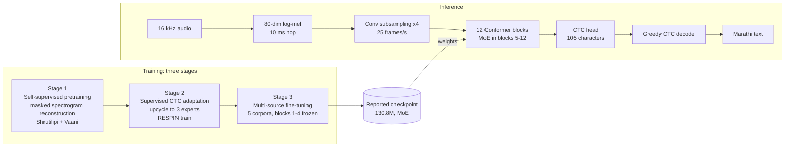

# Method: Dialect-Aware Sparse MoE Conformer for Marathi ASR

Panel preparation guide. It explains the whole system in the order you would present it: problem, model, training, inference, evidence, then the questions a panel is likely to ask. Every code fact was read from this repository; every number comes from `final.md` and the `evals/` folder. Section 12 lists the few values to double-check before you stand up.

---

## 1. The one-minute version

- **Problem.** Marathi has regional dialects (Malvani, Ahirani, Varhadi) that differ from Standard Marathi in pronunciation and word forms. A single dense speech model trained on all of them tends to flatten dialect words into Standard forms and makes more errors on the regional dialects.
- **Idea.** Keep one shared acoustic model, but let the upper half of the encoder route each audio frame to one of three small expert networks. The experts can specialise; the shared path keeps Standard Marathi stable.
- **Result.** At the same 130.8M total parameters, the MoE gets **19.50% WER** on the held-out RESPIN test set versus **36.13%** for a dense model. The gain is **16.63 points** and holds in every dialect.
- **Honest limits.** SraVaani-1.0 (about 430M parameters) is better on RESPIN (15.77%). Our models are weak out of domain (IndicVoices 59.2%, FLEURS 36.7%). The MoE is slower than dense in the current code even though it uses fewer parameters per frame.

---

## 2. System at a glance



The dense baseline uses the same pipeline with ordinary feed-forward layers instead of experts (Section 5.2).

---

## 3. Inputs: data and text

| Item | What it is |
| :--- | :--- |
| Audio | 16 kHz mono. Resampled on load. |
| Text units | Characters. Vocabulary of 105 symbols: `<blank>` (0), `<unk>` (1), `<pad>` (2), space (3), then Devanagari letters and signs. |
| Dialect label | RESPIN gives each utterance a dialect (D1 Malvani, D2 Ahirani, D3 Standard, D4 Varhadi). Used only as an optional training signal in Stage 2 and for analysis. **Not needed at inference.** |
| Scoring text | Reference and prediction both pass through the same normaliser (`mr-norm-1`): Unicode NFC, remove ZWNJ/ZWJ, unify nukta forms, harmonise anusvara/chandrabindu, strip punctuation. |

Training data by stage is in Section 5. Evaluation data is in Section 8.

---

## 4. The model

### 4.1 Front end and encoder

1. **Log-mel features.** 25 ms window, 10 ms hop, 80 mel bands, log with a floor of 1e-5. Computed on the GPU from the waveform. Fixed, not learned.
2. **Convolutional subsampling (x4).** Two stride-2 convolutions then a linear layer. 100 frames/s becomes **25 frames/s**, so each encoder step covers 40 ms. This makes attention four times shorter.
3. **Positional information.** Sinusoidal position encoding is added once after subsampling, and rotary position embeddings (RoPE) are applied inside every attention layer.
4. **12 Conformer blocks**, `d_model` 512, 8 attention heads, convolution kernel 31, dropout 0.1. Each block, in order:
   - feed-forward module (half-step residual: `x + 0.5 * FFN(x)`),
   - multi-head self-attention with RoPE,
   - convolution module (pointwise conv, GLU, depthwise conv, norm, SiLU, pointwise conv),
   - second feed-forward module (**this is the one replaced by the MoE layer in blocks 5-12**),
   - final layer norm.
5. **CTC head.** Layer norm, dropout, linear to 105 outputs, log-softmax.

Attention is full-context in this work (no chunk mask). The code supports chunked masks for streaming, but no result here uses them.

### 4.2 The MoE layer (blocks 5-12)

In each of blocks 5 to 12 the second feed-forward module becomes a `SparseMoELayer`. For one frame `x`:

```
shared  = x + 0.5 * FFN_shared(x)                  # always active
p       = softmax(Router(x))                       # 3 probabilities, Router = Linear(512 -> 3)
k       = argmax(p)                                # top-1 expert for THIS frame
output  = shared + p[k] * 0.5 * FFN_expert_k(x)    # expert adds a gated correction
```

- Three experts per block, each an ordinary feed-forward module with expansion 4 (2.10M parameters).
- The shared feed-forward path is **always on**. Experts only add to it, so Standard Marathi keeps a stable route.
- Routing is **per frame**: every frame picks its own expert (`moe/moe_layer.py`). The router sees the frame's hidden state, which already contains attention and convolution context, so the decision is informed by neighbouring audio.
- The router learns only through the gate `p[k]` that scales the expert correction (plus a load-balancing loss in Stage 2).

**Parameter counts** (measured from the checkpoint):

| | Dense baseline | MoE |
| :--- | :---: | :---: |
| Feed-forward expansion | 8 | 4 (shared) + 3 experts of 4 in blocks 5-12 |
| Total parameters | 130.8M | 130.8M |
| Parameters used per frame | 130.8M | **97.2M (74.3%)** |

The dense model is deliberately made as big as the MoE's *total* size, so any gain is not from extra capacity.

### 4.3 Training objective

- **Stage 1:** masked reconstruction loss. Predict the original spectrogram on masked frames; loss = L1 + 0.5 * L2.
- **Stages 2 and 3:** **CTC loss** (`blank` = 0, `zero_infinity`). CTC learns the alignment between 25 fps encoder frames and characters without frame-level labels.
- **Stage 2 only:** plus 0.01 * a Switch-Transformer-style load-balancing loss, so experts do not collapse to one.

---

## 5. Training flow

### 5.1 Stage 1: self-supervised pretraining

| | |
| :--- | :--- |
| Goal | Learn general acoustic representations without transcripts. |
| Data | Shrutilipi (news audio) and Vaani (spontaneous speech), streamed. MoE run: 1,160,977 utterances, 1,763.9 h, one epoch. IndicVoices excluded. |
| Task | Hide 40% of the spectrogram in contiguous spans (about 10 frames = 100 ms, filled with zeros). The encoder plus a small reconstruction head must rebuild the hidden frames. |
| Loss | L1 + 0.5 * L2 on masked positions only. |
| Optimiser | AdamW, peak LR 4e-4, weight decay 1e-4, betas (0.9, 0.98), 1,000 warm-up steps then cosine decay, gradient clipping 5.0, mixed precision. |
| Size | MoE-architecture run: 18,141 steps, batch 64. Dense run: 30,000 steps. |

Why: the encoder starts with useful features, so supervised steps need far fewer labelled hours.

### 5.2 Stage 2: supervised CTC adaptation (and the MoE conversion)

Starting point: the Stage 1 encoder. A CTC head is added (random init).

**Dense baseline.** Plain CTC training of the same encoder with feed-forward expansion 8. 80,000 steps.

**MoE, "sparse upcycling".** At step 0, blocks 5-12 are converted:
- the existing feed-forward weights are **cloned** into the shared path and into all three experts,
- a router is added (small random init),
- so the converted model starts as a function-preserving copy of the pretrained model.

Training phases (80,000 steps):

| Steps | Phase | What happens |
| :--- | :--- | :--- |
| 1 - 3,000 | CTC warm-up | CTC loss only; no balancing loss. Routing is the learned router (the code does not disable it, despite the log message calling this "no MoE routing"). |
| 3,001 - 18,000 | Hard routing (**oracle**) | Each utterance is sent to the expert of its dialect label (D1 to expert 0, D2 to 1, D4 to 2; D3 uses the shared path only). This is **utterance-level and uses labels**. |
| 18,001 - 80,000 | Learned routing | The router decides per frame. No labels used. |

Other settings:
- Data: RESPIN, 768,893 of its 809,934 training-side utterances (the other 41,041, from separate speakers, are held back for Stage 3), utterances between 1 and 16 s (the loader skips files that are not 16 kHz).
- Augmentation: speed perturbation (0.9x or 1.1x, 50% of utterances), additive noise at 15-30 dB SNR (30% of utterances), and SpecAugment during training (2 frequency masks up to 27 bands, 5 time masks up to 40 frames).
- Learning rate: peak 1.5e-4, AdamW (wd 1e-4, betas 0.9/0.98), 1,000 warm-up then cosine to 5%. Blocks 1-4 train at one tenth of the rate; the expert and shared feed-forward modules, blocks 5-12 and the CTC head train at the full rate.
- Gradient accumulation 4, clipping 5.0, mixed precision.

### 5.3 Stage 3: multi-source fine-tuning (the reported checkpoints)

| | |
| :--- | :--- |
| Goal | Make the model robust across speakers, channels and writing styles, using several corpora. |
| Frozen | Blocks 1-4 (the shared acoustic front of the encoder). |
| Trained | Blocks 5-12 (including shared feed-forward, experts and routers) and the CTC head: 98.97M parameters (75.7%). |
| Loss | CTC only. **No dialect labels, no balancing loss**: routing is entirely learned. |
| Optimiser | AdamW, peak LR 3e-5, decaying by cosine to 10% of peak (as coded), 1,000 warm-up steps, batch 32 x accumulation 4, mixed precision, clip 5.0. |
| Steps | MoE: last saved step 342,000 (400,000 planned). Dense: 300,000. |
| Checkpoint | `best_model.pt`: the best checkpoint by logged training-batch CER. |

Data: each training example is drawn from one of five sources with fixed probabilities. Utterances outside 0.8 to 15 s are filtered out, and the same speed and noise augmentation as Stage 2 is applied.

Sources:

| Source | Sampling weight | Size |
| :--- | :---: | :---: |
| IISc RESPIN (all training-side data, no split) | 0.35 | 809,934 utterances |
| AI4Bharat Kathbath (train split 84,070 + noisy set 1,631; valid split is evaluation-only) | 0.30 | 85,701 |
| Shrutilipi + Vaani stream | 0.15 | streamed |
| OpenSLR64 Marathi (the whole corpus) | 0.10 | 1,569 |
| Common Voice Marathi (the 1,205-utterance Vistaar subset, not the full corpus) | 0.10 | 1,205 |

RESPIN **test** is never used. Kathbath train is used, which matters for Section 8.

No percentage split is applied to any source in Stage 3; each is used in full.

**Why sampling weights?** The corpora differ hugely in size. Sampling utterances in proportion to size would make about 90% of every batch RESPIN and nearly erase the two small corpora, so the loader picks a source first (with the weights above) and then a random utterance from it. The code does not state the reason for these exact values; the effect is to fix each corpus's share of every batch.

Expected passes over each corpus (weights x steps x batch 32, not counted from logs):

| Source | MoE (342,000 steps) | Dense (300,000 steps) |
| :--- | :---: | :---: |
| RESPIN | ~5 passes | ~4 passes |
| Kathbath | ~38 passes | ~34 passes |
| OpenSLR64 | ~698 passes | ~612 passes |
| Common Voice subset | ~908 passes | ~797 passes |

So the small corpora are repeated hundreds of times and Kathbath dozens of times. Memorisation was not measured. The Common Voice subset and the 1,631-utterance Kathbath noisy set come from the Vistaar benchmark folders and were used for training, so no Common Voice or Kathbath-noisy result is reported.

### 5.4 Checkpoint selection

Ten trained checkpoints (8 MoE, 2 dense) were scored on RESPIN and Kathbath with one protocol. The reported MoE (Stage 3 vanilla SFT) and dense (Stage 3 final alignment) were best in their families. Later GRPO and polishing stages scored worse and were deleted.

### 5.5 Optional PEFT control (LoRA)

Three rank-16 LoRA adapters (Malvani, Ahirani, Varhadi) are trained on the frozen dense encoder (3.93M trainable parameters each). They test whether dialect-specific adaptation alone, given the **true dialect label at inference**, can match the MoE. It cannot (Section 9).

---

## 6. Inference flow, step by step

1. Read audio, convert to mono, resample to 16 kHz.
2. Compute 80-dim log-mel features (100 frames/s).
3. Subsample x4: **25 encoder frames/s**.
4. Run 12 Conformer blocks. In blocks 5-12, for every frame the router picks the top-1 expert and adds its gated correction to the shared path. No dialect label is needed.
5. CTC head gives a probability over 105 symbols per frame.
6. **Greedy CTC decoding:** take the most likely symbol per frame, merge repeats, delete blanks.
7. Map symbols to characters, tidy whitespace.
8. For scoring only: apply `mr-norm-1` to reference and prediction, then compute WER (word errors / reference words) and CER.

No language model and no beam search are used for any reported result. Beam search with a lexicon was tested and changed WER by only 0.4 points.

**What the run-time cost is.** At batch 1 the dense model takes 26.7 ms median per utterance and the MoE 72.1 ms (fp32, RTX A5000). Both run far faster than real time.

---

## 7. Why each design choice (short answers)

| Choice | Reason |
| :--- | :--- |
| Conformer encoder | Standard strong ASR encoder: attention captures long context, convolution captures local sound patterns. |
| CTC, not attention decoder | Simple, fast, no autoregressive decoding; fits character output and the frame-level routing analysis. |
| Character vocabulary | No tokenizer to train; handles dialect spellings without out-of-vocabulary words. |
| Pretraining first | Gives the encoder acoustic knowledge before scarce labelled data. |
| Experts only in blocks 5-12 | Lower blocks learn universal sound features; upper blocks carry language and dialect detail. Supported by the bypass test (Section 9), not by a retraining ablation. |
| Shared path always on | Keeps Standard Marathi stable and gives experts a safe residual starting point. |
| Upcycling | Experts start as copies of a good feed-forward layer instead of random weights. |
| Hard routing phase | Pushes experts apart early by giving them dialect-specific training signal; later phases remove the labels. |
| 3 experts | One per regional dialect in the data. This is a design choice; it was not tuned (see Section 11). |
| Dense baseline with expansion 8 | Same total parameters as the MoE, so the comparison is capacity-matched. |

---

## 8. Evaluation

| Dataset | Split | Utterances | Relation to our training |
| :--- | :--- | :---: | :--- |
| IISc RESPIN | official test | 2,170, 160 unseen speakers | Same corpus; no speaker or sentence shared with any training source (audited). |
| Kathbath | valid | 2,378, 20 speakers | **In-domain**: all 20 speakers also appear in Kathbath train. |
| IndicVoices | valid | 3,673 | Not used in training. |
| FLEURS (Marathi) | test | 1,015 | Not used in training. |

Baselines: **SraVaani-1.0** (about 430M parameters, FastConformer, hybrid TDT-CTC) and **IndicConformer-600M** (hybrid CTC + RNNT, CTC mode used). All four systems use the same audio loading, normaliser and scoring code. Confidence intervals: 1,000 utterance-level bootstrap resamples; paired MoE-vs-dense intervals use 10,000 speaker-clustered resamples over the 160 test speakers.

---

## 9. Results and what each proves

### 9.1 Headline (RESPIN test, WER %)

| Model | Params | D1 Malvani | D2 Ahirani | D3 Standard | D4 Varhadi | **ALL** |
| :--- | :---: | :---: | :---: | :---: | :---: | :---: |
| SraVaani-1.0 | ~430M | 21.71 | 17.80 | 8.97 | 14.17 | **15.77** |
| **MoE (ours)** | 130.8M | 25.68 | 21.58 | 11.15 | 19.11 | **19.50** |
| IndicConformer-600M | 600M | 34.59 | 24.64 | 11.57 | 24.29 | **23.94** |
| Dense (ours) | 130.8M | 43.99 | 38.27 | 24.88 | 36.75 | **36.13** |

MoE vs dense: **-16.63 points** (46% relative), paired speaker-bootstrap 95% CI [15.72, 17.56], p < 0.0001, significant in every dialect (13.7 to 18.3 points).

### 9.2 Other datasets (WER %)

| Model | Kathbath (in-domain) | IndicVoices (OOD) | FLEURS (OOD) |
| :--- | :---: | :---: | :---: |
| MoE | 29.41 | 59.20 | 36.74 |
| Dense | 50.69 | 77.19 | 57.04 |
| SraVaani-1.0 | 12.93 | 15.21 | 17.79 |
| IndicConformer-600M | 13.52 | 15.96 | 18.58 |

The MoE improves on dense everywhere, but both of our models are far behind the large baselines out of domain.

### 9.3 Do the experts actually do something? (same checkpoint, no retraining)

| Condition | RESPIN WER |
| :--- | :---: |
| Learned routing (normal) | **19.50** |
| Oracle routing: dialect label picks the expert | 22.93 |
| Random expert per utterance | 25.55 |
| All experts bypassed (shared path only) | 29.05 |

- Learned frame-level routing beats the oracle-label routing, so the router finds something better than the dialect label alone.
- Dropping one expert hurts its own dialect most: expert 0 off raises Malvani WER by 13.7 points; expert 1 raises Ahirani by 7.3; expert 2 raises Varhadi by 8.5.
- Bypassing blocks 9-12 costs 8.1 points; blocks 5-8 only 0.9. The upper blocks do most of the dialect work.

### 9.4 Is it really frame-level? (240 test utterances, batch 1)

- Yes in mechanism: each frame is routed independently by the router.
- In behaviour the experts are **sticky**: adjacent frames change expert 12-35% of the time versus 55-67% expected by chance, so an expert persists for about 3-8 frames. No utterance sends more than about 70% of its frames to one expert.
- Dialect is only partly readable from routing: Malvani clearly prefers expert 0 in blocks 11-12 (63% and 71% of frames); Ahirani, Standard and Varhadi are spread across experts.

### 9.5 Does it keep dialect words? (dialect-skewed word recall, D1 / D2 / D4)

| Model | Recall |
| :--- | :---: |
| MoE | 89.7 / 90.9 / 93.0 % |
| Dense | 74.2 / 79.7 / 83.2 % |
| SraVaani-1.0 | 86.9 / 92.9 / 91.3 % |
| IndicConformer-600M | 59.8 / 74.5 / 54.3 % |

IndicConformer often rewrites dialect forms into Standard Marathi (for example `आसा` to `असा`, `मले` to `मला`). The word lists are found automatically from the test references, so this is a proxy, not a linguist-annotated test.

### 9.6 LoRA control

| System | Needs the dialect label | RESPIN WER |
| :--- | :---: | :---: |
| Dense | no | 36.13 |
| Dense + oracle LoRA adapters | **yes** | 34.49 |
| MoE | no | **19.50** |

### 9.7 Cost

Parameters used per frame: 97.2M of 130.8M (25.7% fewer). Measured speed: the MoE is **2.7x slower** at batch 1 and about 25% lower throughput at batch 16 (peak memory the same), because the current implementation dispatches frames to experts with per-expert masked indexing that was not optimised. The efficiency claim is the parameter count, not speed.

---

## 10. Data integrity (what you can say with confidence)

- RESPIN test: **0 of 160** speakers and **0 of 711** distinct prompts appear in any training source.
- IndicVoices and FLEURS: no sentence overlap with any training text.
- Kathbath valid: all 20 speakers are in Kathbath train; 9 sentences overlap. So Kathbath is **in-domain** and is not offered as a transfer result.
- Model weights and checkpoints are not in the repository; scripts and results are.

---

## 11. Likely panel questions and honest answers

| Question | Answer |
| :--- | :--- |
| Is your MoE the best system? | No. SraVaani-1.0 is better on RESPIN (15.77% vs 19.50%) with about 3.3x the parameters. The claim is dialect-aware accuracy at a fixed parameter budget, and the MoE beats the capacity-matched dense model and IndicConformer-600M on RESPIN. |
| Why is out-of-domain so poor? | Training is built around RESPIN-style prompted read speech plus Kathbath; it was never designed or tested as a general Marathi recogniser. Both our models are far behind on IndicVoices and FLEURS. We report it. |
| Is it really frame-level routing? | Mechanism yes (each frame picks an expert). Behaviour is sticky: experts persist for roughly 3-8 frames and no utterance uses one expert. Only Malvani maps clearly to one expert. |
| Did you use dialect labels? | In training only during Stage 2 hard routing (steps 3,001-18,000 of 80,000). Never in Stage 3 and never at inference. |
| Why 3 experts and blocks 5-12? | Three regional dialects in the data; upper blocks carry dialect detail. These are design choices, not tuned: we show inference-time evidence (dropping experts, bypassing blocks) but did not retrain with other expert counts or placements. |
| Why those sampling weights? | They fix each corpus's share of every batch so small corpora are not swamped by RESPIN. The code does not record why these exact values were chosen, and the side effect is heavy repetition of the small corpora (hundreds of passes) and of Kathbath (dozens). |
| Single training run? | Yes for the headline models; seed variance was not measured for them. A reduced-budget seed and ablation study is queued (placeholder Section 5.6 in `final.md`). The 16.6-point gap is large compared with typical seed noise but that is not measured here. |
| Is your gain just from more capacity? | No. The dense baseline has the same 130.8M total parameters. |
| Is Kathbath leakage a problem? | Kathbath speakers overlap train, so those numbers are in-domain and we say so. The RESPIN headline has no speaker or prompt overlap. |
| Why is MoE slower with fewer parameters? | Per-frame expert dispatch in plain PyTorch. A fused or batched dispatch would reduce it; not done. |
| Does it work for streaming? | The architecture supports chunked attention, but no result here uses it. All results are offline, full-context. |
| What about a language model? | Not used. A lexicon beam search changed WER by 0.4 points; an n-gram LM was dropped because its training text could not be audited for test overlap. |

---

## 12. Values to double-check before the panel

These came from logs and configs that do not fully agree. Know which you will quote.

1. **Stage 2 batch size.** The Stage 2 log printed batch size 64 and the run description says 64, while `config.json` lists 32 with gradient accumulation 4. Quote it as "batch 32-64 with accumulation 4" unless you check the original launch command.
2. **Stage 3 minimum learning rate.** The script takes `--min_lr 5e-6` but the scheduler uses `min_lr_ratio = 0.1` of the peak (3e-6). Say "cosine decay to a small fraction of the peak".
3. **Stage 3 length.** The MoE run reached at least step 343,600; the last saved checkpoint is step 342,000 and 400,000 was planned. The reported file is `best_model.pt`, which is selected by training-batch CER and need not be the last step.
4. **Padding.** `forward_ctc` is called without a padding mask. Batches are sorted by length to keep padding small, but batch-1 and batch-16 results were not compared for WER.
5. **Stage 1 for the dense and MoE runs differ** (dense 30,000 steps; MoE 18,141 steps), because the two runs used different pretraining configurations. State the Stage 1 length per model.

---

## 13. Where everything lives

| Topic | File |
| :--- | :--- |
| All numbers, tables, claims | `final.md` (regenerated by `scripts/build_final_md.py` from `evals/*.json`) |
| Model | `model/asr_model.py`, `model/conformer.py`, `moe/moe_layer.py`, `moe/upcycling.py` |
| Stage 1 | `pretraining/train.py` |
| Stage 2 | `moe/train_moe.py`, `dense/train_dense.py` |
| Stage 3 | `final_alignment/train_alignment.py`, `data_utils/multi_source_calib_loader.py` |
| Evaluation | `eval_offline.py`, `adapters/`, `normalizer.py` |
| Routing and ablation analyses | `scripts/rerun_paper_evals.py`, `scripts/ablate_moe_layers.py`, `scripts/measure_routing.py` |
| Audits | `scripts/audit_leakage_all.py`, `scripts/audit_kathbath_overlap.py` |
| Queued training ablations | `scripts/run_ablation_queue.py`, `ABLATION_RUNBOOK.md` |

## 14. Suggested order for a 10-minute talk

1. The dialect problem and one example of a flattened word (Section 1, Section 9.5).
2. The model in one picture: shared path plus per-frame experts (Section 4.2).
3. The three training stages and why (Section 5).
4. Inference in six steps (Section 6).
5. The headline result and the capacity-matched comparison (Section 9.1).
6. Proof the experts matter and the routing is learned (Sections 9.3, 9.4).
7. Limits stated first: SraVaani, out-of-domain, speed, single run (Section 11).
